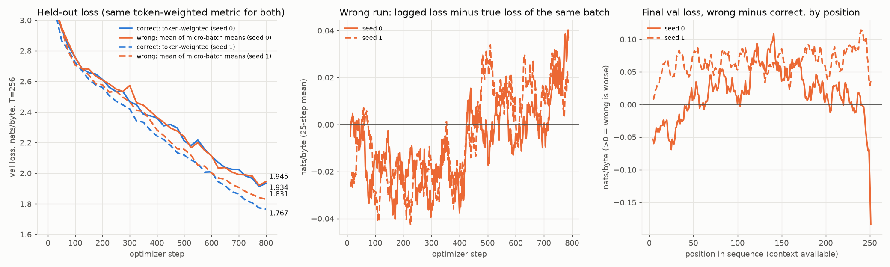
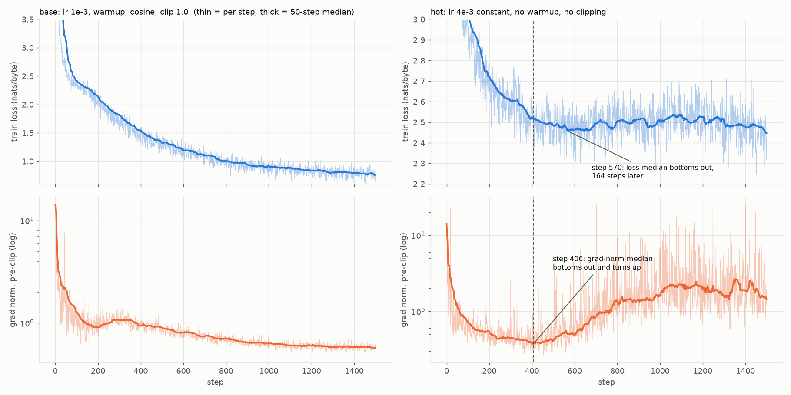

# Making a small training loop tell the truth about itself

Setup: byte-level GPT (vocab 256, D=384, 6 layers, 6 heads, ctx 256, **10.9M params**), trained with AdamW
on CPython's stdlib source (7.6 MB train / 0.4 MB val). Apple M4 Max (40-core GPU), PyTorch 2.15, MPS backend.
Every number below comes from a file in this directory (`out_*.txt`, `*_results*.json`, `*.png`).

## Reproduce

Needs Python 3.12 (3.14 had no torch wheel when this was written) and, for the GPU numbers, an Apple Silicon Mac.
Other machines fall back to CPU, except `mfu.py` and `train.py`, which call `torch.mps` directly.
The corpus is whatever Python stdlib is installed, so no data download is needed.

```bash
python3.12 -m venv .venv && .venv/bin/pip install -r requirements.txt
.venv/bin/python shapes.py      # 1. shapes             -> out_shapes.txt
.venv/bin/python gradcheck.py   # 2. finite differences -> out_gradcheck.txt   (CPU, fp64)
.venv/bin/python accum.py 800   # 3. accumulation       -> accum_results.json  (~2 min)
.venv/bin/python plot_accum.py  #                        -> accum.png
.venv/bin/python train.py 1500  # 4+5. main loop        -> train_results.json  (~6 min, resumable)
.venv/bin/python plot_train.py  #                        -> gradnorm.png
.venv/bin/python mfu.py 5       # 5. MFU ablations      -> stdout              (~5 min)
.venv/bin/python fp_bits.py     # 6. 0.1 in bits        -> out_fp_bits.txt
```

`train.py` writes a checkpoint every 100 steps to `ckpt/` (weights, AdamW state, step, sampler RNG, logs) and
resumes from it after a crash; delete `ckpt/` to start over. It was tested by SIGKILLing a run between steps 600 and 700 and
restarting: it resumed at step 600 with no loss jump, and drifted from an uninterrupted run no more than two
uninterrupted runs drift from each other (MPS is not bitwise deterministic). See `out_train_resumed.txt`.

**Expect different numbers on rerun.** MPS is nondeterministic, and timing depends on what else the machine
is doing. Section 4 and `gradnorm.png` use `train_results_uninterrupted.json` (the original run); the
"quiet run" in section 5 is `out_mfu_run1_quiet.txt`, and the 5-rep table is `out_mfu.txt`.

---

## 1. Every tensor shape in one step (`shapes.py` → `out_shapes.txt`)

B=32, T=256, D=384, H=6, hd=64, L=6, V=256.

| tensor | shape | what the dimensions mean |
|---|---|---|
| idx | (32, 256) | B sequences × T byte ids |
| tok_emb(idx) | (32, 256, 384) | each byte id looked up as a D-vector |
| pos_emb | (256, 384) | one learned vector per position, broadcast over B |
| x = tok + pos | (32, 256, 384) | residual stream entering block 0 |
| qkv | (32, 256, 1152) | Q, K, V for every token, packed along the last dim (3D) |
| q / k / v | (32, 6, 256, 64) | D split into H heads of hd; heads moved before T so each head is its own batch |
| scores = qkᵀ/√hd | (32, 6, 256, 256) | B, H, query position, key position |
| softmax(mask(scores)) | (32, 6, 256, 256) | each row is a distribution over keys ≤ that query |
| att @ v | (32, 6, 256, 64) | per-head weighted sum of values |
| heads merged | (32, 256, 384) | H heads concatenated back into D |
| MLP hidden | (32, 256, 1536) | 4D-wide per token |
| block output | (32, 256, 384) | residual stream; same shape after all 6 blocks |
| logits | (32, 256, 256) | score for every next byte at every position |
| logits.view(-1,V) | (8192, 256) | B·T flattened into one list of classifications |
| per-token loss | (8192,) | −log p(correct byte) per position |
| loss | () | the mean; backward starts here |
| W_qkv.grad | (1152, 384) | nn.Linear stores (out, in); a grad always has its parameter's shape |
| tok.weight.grad | (256, 384) | rows for bytes absent from the batch are exactly 0 |
| clip_grad_norm_ | () | L2 norm of all gradients as one vector, before clipping |
| Adam exp_avg, exp_avg_sq | (1536, 384) each | 1st and 2nd moment, same shape as the param → optimizer state = 2× params |

What the printout shows: the largest tensor in the step is the **attention score matrix**, 12.6M floats
(50 MB) per layer. That is 4× the residual stream. It's the one that `scaled_dot_product_attention`
avoids storing in full; the logged run writes attention out explicitly so the matrix is visible.

## 2. One gradient checked by hand (`gradcheck.py` → `out_gradcheck.txt`)

Central difference (L(w+ε) − L(w−ε)) / 2ε in **float64** on CPU, ε = 1e-6, against `backward()`:

| weight | backward() | finite diff | rel. err |
|---|---|---|---|
| blocks.2.fc.weight[17,101] | −8.9959525998e-04 | −8.9959550920e-04 | 2.8e-07 |
| head.weight['e', 0] | 8.3368355338e-02 | 8.3368355774e-02 | 5.2e-09 |
| pos.weight[10,3] | −2.0082442129e-02 | −2.0082441932e-02 | 9.8e-09 |
| blocks.1 key weight [200,50] | −1.0186343518e-06 | −1.0191847366e-06 | **5.4e-04** |

Six of the seven agree to 6–9 digits. **The key weight looked off.** I traced it in two steps:

- **The mismatch was my ε, not backward().** That gradient is tiny (1e-6), and the loss is 5.5. The
  subtraction L(w+ε) − L(w−ε) loses about ε_mach·L/ε ≈ 6e-10 to roundoff, the same size as the
  error I saw. Sweeping ε confirms it: error falls to **2.9e-13 at ε=1e-4** (rel. 3e-7), then rises
  again for smaller ε. Truncation error shrinks with ε and roundoff grows, so the best ε is in between.
- **Why it is tiny: softmax ignores a constant added to all scores.** A key *bias* adds the same amount
  to every score in a query's row, so its true gradient is exactly zero. backward() gives
  −9.7e-21 and 8.7e-21 (zero up to fp64 noise); the finite difference gives 0 and −4e-12. Key
  *weights* only matter through how keys differ between positions, which is small at init.

**In float32 the same check falls apart, and backward() is not the problem.** fp32 backward matches the
fp64 one to 3e-7. But a loss of 5.5 in fp32 has a spacing (ulp) of 4.8e-7, so L(w+ε) − L(w−ε) can only
take whole multiples of it:

| ε | fp32 finite diff | rel. err vs fp64 |
|---|---|---|
| 1e-1 | −8.96e-04 | 3.5e-03 (best it gets) |
| 1e-3 | −9.54e-04 | 6.0e-02 (exactly 4 ulps / 2ε) |
| ≤1e-4 | **0.0** | 100% |

So a finite-difference check must run in fp64. In fp32 you will "find" bugs that aren't there.

## 3. Gradient accumulation broken on purpose (`accum.py`, `plot_accum.py` → `accum.png`)

Each optimizer step uses 4 micro-batches of 16 rows. Each micro-batch has its own length drawn from
{16, 32, 64, 128, 256}, so token counts differ by up to 16×. The two runs share the init and the data
stream; only the loss reduction differs.

- **correct:** Σ token losses over all micro-batches / total tokens
- **wrong:** mean of each micro-batch's mean loss. A token in a 16-long micro-batch then counts 16×
  as much as one in a 256-long micro-batch.

**Proof the correct one really is correct:** its gradient matches a single padded, masked batch to
**rel. 1e-6** at every checkpoint. The wrong one is off by **14% to 81%** (cosine 0.69 to 0.99) on
the same data.



| | correct val | wrong val | gap |
|---|---|---|---|
| seed 0 | 1.934 | 1.945 | +0.011 |
| seed 1 | 1.767 | 1.831 | **+0.064** |

What the plot shows, stated plainly:
- **Seed 1 shows a clear, persistent gap. Seed 0's final gap is within noise:** its gap swings between
  −0.03 and +0.11 during training. The cost of this bug is real but varies by run. With 2 seeds, I
  wouldn't quote a single number for it.
- **The damage lands on long contexts**, as the reweighting predicts. For positions ≥128 the wrong run
  is +0.016 / +0.068 worse. For seed 0 at positions <16 it is actually 0.05 *better*, because it was
  trained mostly on short-context tokens.
- **The wrong run's logged loss is also misleading** (middle panel). It differs from the true loss of
  the same batch by up to ±0.04, depending on which lengths happened to be drawn. Its loss curve
  measures something different on every step.

## 4. Grad norm every step: a step where it moved before the loss (`train.py`, `plot_train.py` → `gradnorm.png`)

Two runs. **base:** lr 1e-3, warmup, cosine, clip 1.0. **hot:** lr 4e-3, constant, no warmup, no clipping.



**Step 406 in the hot run.** That is where the 50-step median grad norm bottoms out (0.371) and turns up.
The loss median keeps falling for another **164 steps**, from 2.519 to its floor of 2.456 at step 570.
By then the grad norm is already up 1.37×. After that the loss stalls and drifts up to about 2.53,
while the grad norm climbs about 6× and spikes to 10–20.

The pattern of loss still falling while grad norm rises usually means the learning rate is too high for
the sharpening curvature: the optimizer starts bouncing across a valley instead of descending it. Here
the grad norm warned about 160 steps before the loss stopped improving. The base run never does this;
its grad norm falls along with the loss the whole way.

A second finding: **a single grad-norm spike is not the signal.** Step 430 spikes 4.9× (1.93 vs a
baseline of 0.39), and the loss on that step is 2.500, inside the per-step noise of ±0.062. Nothing
follows. What matters is the trend, not one spike.

## 5. MFU, reported honestly (`mfu.py` → `out_mfu.txt`)

**FLOPs per token** = 6·N_matmul + 12·L·T·D = 6·10.72M + 7.08M = **71.4 MFLOP** (PaLM convention:
the full T×T attention is counted, not the causal half).

**Peak (the denominator).** Apple publishes no TFLOPS figure, so I derived one:
40 cores × 128 FP32 lanes × 2 (FMA) × ~1.58 GHz ≈ **16.2 TFLOPS fp32**. The clock speed is itself
unpublished. A 4096³ fp32 matmul reached **13.6 TFLOPS** (84% of that) on a quiet run, which supports
the estimate.

**My number: 5.69 TFLOPS = 35% MFU** (42% against the measured matmul ceiling). This is the median step
time (103 ms) of the real 1500-step training loop, data loading and per-step `.item()` included. If you
count attention FLOPs only for the causal half, it drops to about 32%.

| ablation (5 interleaved reps) | median ms/step | MFU median | best rep |
|---|---|---|---|
| same step, batches pre-staged | 96 | 38% | 45% |
| no per-step `.item()` sync | 92 | 39% | 43% |
| B=8 | 24 | 37% | 38% |
| B=128 | 369 | 39% | 45% |
| **D=1024, L=8 (101M params)** | 318 | **50%** | **59%** |
| bf16 autocast | 81 | 44% | 47% |
| torch.compile | 81 | 45% | 50% |

**What I think costs the distance to 40%, most to least likely:**
1. **This isn't a dedicated machine.** The *identical* step took anywhere from 81 to 178 ms across
   reps. Even the plain matmul ceiling moved between runs (fp16: 15.0 vs 8.3 TFLOPS). During the run
   WindowServer was at 45% CPU (it composites on the same GPU), plus an XProtect scan and Zoom. Best
   case is 45%, the typical case is 38%, and a 3000-step sustained run sits at 35%. That gap alone
   covers most of the distance to 40%.
2. **The model is too small to fill the GPU.** With D=384 the matmuls are small and per-kernel
   overhead dominates. The 101M model reaches 59% best case on the same hardware. This is the one
   lever with an effect clearly bigger than the noise.
3. **Unfused memory-bound ops** (LayerNorm, GELU, softmax, cross-entropy, AdamW's elementwise update).
   torch.compile's best rep is 50% against 45%, a few points at most.

**What is *not* costing it, checked:** data loading. I guessed this first, and it was wrong:
`get_batch` takes 0.6 ms of a ~100 ms step. The per-step `.item()` sync costs about 1%, within noise.
**bf16:** in the quiet run, fp32 and bf16 steps took 80.7 and 80.5 ms. The bf16 matmul ceiling is
only ~10% above fp32, because this GPU has no faster bf16 matrix units. The gap in the table above is
inside the noise band.

Context on "40%": that target assumes a datacenter GPU measured against its bf16 tensor-core peak. On
an H100, this 11M model would score far below 40%, because its matmuls are too small for the tensor
cores.

## 6. 0.1 in fp32, bf16 and fp8 E4M3, by hand (`fp_bits.py` → `out_fp_bits.txt` confirms every bit)

**Step 1: normalise.** 0.1 = 1.6 × 2⁻⁴. The exponent is −4; the mantissa (fraction bits) is the
binary expansion of 0.6.

**Step 2: 0.6 in binary**, by repeated doubling: 0.6→**1**.2, 0.2→**0**.4, 0.4→**0**.8, 0.8→**1**.6,
0.6→**1**.2, … so 0.6 = 0.**1001 1001 1001 …** in binary, with the pattern repeating forever.

**Step 3: truncate and round to nearest even.** The bits after the cut are 1001…, which is more than
half an ulp, so every format rounds up.

| format | sign | exponent (bias) | mantissa | hex | value | rel. error |
|---|---|---|---|---|---|---|
| fp32 (1-8-23) | 0 | 01111011 (−4+127=123) | 1001100110011001100110**1** | 3DCCCCCD | 0.100000001490 | 1.5e-8 |
| bf16 (1-8-7) | 0 | 01111011 (−4+127=123) | 100110**1** | 3DCD | 0.10009765625 | 9.8e-4 |
| fp8 E4M3 (1-4-3) | 0 | 0011 (−4+7=3) | 10**1** | 1D | 0.1015625 | 1.6e-2 |

bf16 is exactly the top 16 bits of fp32, re-rounded. Its nearest E4M3 neighbours are 0.09375 and
0.109375, so fp8 can't tell 0.1 from anything within ±4%.

**Which one I'd train in:** bf16 for the matmuls and activations, with fp32 master weights and
fp32 optimizer state. Standard mixed precision.
- **Why bf16 rather than fp16:** it has fp32's 8-bit exponent (max 3.4e38 vs fp16's 65504), so no
  loss scaling and no overflow or underflow to babysit. Its 3 significant digits are plenty for
  activations and gradients, which carry far more noise than 1e-3 anyway.
- **Why the weights stay in fp32:** a typical update is about 1e-3 of the weight, and the bf16 spacing
  at 1.0 is 2⁻⁷ ≈ 0.0078. `fp_bits.py` shows 1.0 + 0.001 = 1.0 in bf16. The update just vanishes.
- **Why not fp8 E4M3:** 1.6% error per value, and a max of 448 means it needs per-tensor or per-block
  scaling. It pays off only for matmuls on hardware with fp8 tensor cores (H100 and later). Even then
  it's a matmul format; the master weights stay in higher precision.
- **On this specific Mac I'd actually train in fp32.** Section 5 measured no speedup from bf16 here,
  and that would give up precision for nothing.
