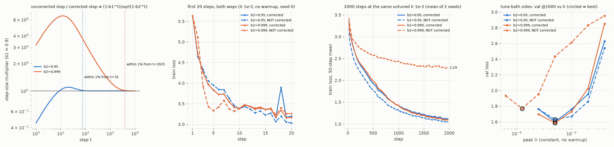
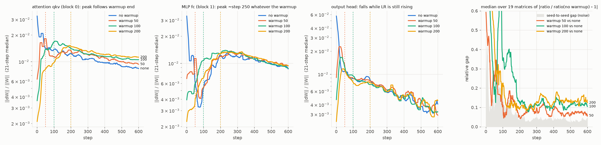
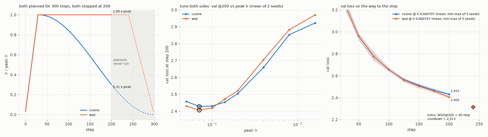
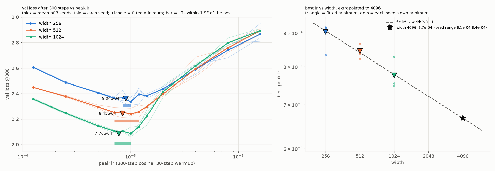

# Session 11: Adam, schedules and learning rates, measured instead of assumed

**Setup.** A small byte-level GPT (4 layers, head size 64, context 128, vocab 256) trained on CPython's
standard-library source (7.6 MB train / 0.4 MB val), batch 32, Adam, on an Apple M4 Max GPU (PyTorch 2.15,
MPS). Width is 256 unless a task varies it: 3.3M params at width 256, 12.9M at 512, 51M at 1,024.
Same seed means same initial weights and same batch order, so two runs with one seed differ only in what
was changed. Every number below comes from a file in this folder (`out_*.txt`, `*_results.json`, `*.png`).

**The rule followed throughout:** before comparing two methods, tune both. Two of the comparisons below
reversed direction once both sides were tuned (sections 2 and 4).

| task | answer |
|---|---|
| 1. Adam by hand | matches PyTorch on all 30 numbers to ≤ 5.6e-17 (float64 roundoff) |
| 2. Bias correction | step sizes agree within 1% after **76 steps (β2 = 0.95)** or **3,925 steps (β2 = 0.999)**; in loss, it stops mattering for β2 = 0.95 once both are tuned, and never does for β2 = 0.999 |
| 3. Update/weight ratio | with a 100-step warmup, warmup stops pushing the attention and embedding ratios at **steps ~90–190** (at or just after warmup ends); the MLP ratio peaks at ~250 whatever the warmup; a residual offset stays ~3× seed noise to step 600 |
| 4. Cosine vs WSD at step 200 | WSD **2.405** vs cosine **2.431**, WSD better on 5/5 seeds; keep **WSD** |
| 5. LR vs width | minima **9.0e-4 / 8.4e-4 / 7.8e-4** (lr* ∝ width^−0.11); at width 4,096 I'd use **5e-4**, confident to about a factor of 2 |

---

## 1. Adam by hand (`adam_by_hand.py` → `out_adam_by_hand.txt`)

One weight w₀ = 0.5, five gradients g = 0.20, −0.10, 0.30, 0.05, −0.25; lr = 0.1, β1 = 0.9, β2 = 0.999,
ε = 1e-8, no weight decay. The updates are

```
m_t = β1·m_{t-1} + (1-β1)·g_t          m̂_t = m_t / (1 - β1^t)
v_t = β2·v_{t-1} + (1-β2)·g_t²         v̂_t = v_t / (1 - β2^t)
step_t = lr · m̂_t / (sqrt(v̂_t) + ε)    w_t = w_{t-1} - step_t
```

Steps 1 and 2 written out:

| | t = 1, g = 0.20 | t = 2, g = −0.10 |
|---|---|---|
| m | 0.1 × 0.2 = **0.02** | 0.9 × 0.02 + 0.1 × (−0.1) = **0.008** |
| v | 0.001 × 0.04 = **4e-5** | 0.999 × 4e-5 + 0.001 × 0.01 = **4.996e-5** |
| m̂ | 0.02 / 0.1 = **0.2** | 0.008 / 0.19 = **0.0421053** |
| v̂ | 4e-5 / 0.001 = **0.04** | 4.996e-5 / 0.001999 = **0.0249925** |
| step | 0.1 × 0.2 / (0.2 + 1e-8) = **0.0999999950** | 0.1 × 0.0421053 / 0.158090 = **0.0266337** |
| w | 0.5 − 0.1 = **0.4000000050** | **0.3733663** |

All five steps, against PyTorch (`torch.optim.Adam`, float64, gradients injected by hand):

| t | g | m | v | m̂ | v̂ | step | w |
|---|---|---|---|---|---|---|---|
| 1 | 0.20 | 0.0200000 | 4.00000e-5 | 0.200000 | 0.0400000 | 0.0999999950 | 0.400000005 |
| 2 | −0.10 | 0.0080000 | 4.99600e-5 | 0.0421053 | 0.0249925 | 0.0266337 | 0.373366303 |
| 3 | 0.30 | 0.0372000 | 1.39910e-4 | 0.137269 | 0.0466833 | 0.0635320 | 0.309834287 |
| 4 | 0.05 | 0.0384800 | 1.42270e-4 | 0.111893 | 0.0356209 | 0.0592857 | 0.250548547 |
| 5 | −0.25 | 0.0096320 | 2.04628e-4 | 0.0235208 | 0.0410075 | 0.0116150 | 0.238933519 |

**Agreement: the worst of all 30 differences is 5.6e-17**, which is float64 roundoff. PyTorch doesn't store
m̂ or v̂, so those are rebuilt from its `exp_avg`, `exp_avg_sq` and step counter. The step is the change
PyTorch actually made to the weight.

Two things the hand calculation makes visible:
- **Step 1 is exactly lr, whatever the gradient.** m̂₁ = g and v̂₁ = g², so m̂/√v̂ = ±1. Adam's first step
  is the sign of the gradient times lr. That's why warmup exists.
- **At t = 5 the gradient is negative (−0.25), but the weight still goes *down*.** Momentum
  (m = +0.0096) still outweighs the new gradient, so the step is +0.0116 against the gradient's direction.

## 2. Bias correction on and off (`bias_correction.py`, `plot_bias.py` → `bias_correction.png`)

Turning off bias correction makes the step at time t larger by a known factor (ignoring ε):

**uncorrected / corrected = (1 − β1ᵗ) / √(1 − β2ᵗ)**

| | t = 1 | t = 20 | peak | within 10% of 1 from | within 1% of 1 from |
|---|---|---|---|---|---|
| β2 = 0.95 | 0.45× | 1.10× | 1.10× at t = 20 | t = 20 | **t = 76** |
| β2 = 0.999 | 3.16× | 6.24× | **6.57× at t = 12** | t = 1,751 | **t = 3,925** |

For β2 = 0.999, the uncorrected optimizer takes steps **3 to 6.6 times too large for the first ~1,750
steps**. For β2 = 0.95 it takes *smaller* steps at first (0.45×), which acts like a short warmup.

My `MyAdam(bias_correction=True)` matches `torch.optim.Adam` to 4.8e-7 in loss over 10 steps, so the
comparison uses one implementation with a single switch.



**First 20 steps (panel 2), constant lr 1e-3, no warmup.** Over steps 3–9 the uncorrected β2 = 0.999 run
has the *lowest* loss of the four (3.33 at step 5 vs 3.83 corrected), because its oversized steps help at
first. Judging from the first 20 steps alone would pick the broken optimizer.

**2,000 steps at the same untuned lr 1e-3** (panel 3; mean of 2 seeds, final val loss):

| | corrected | not corrected |
|---|---|---|
| β2 = 0.95 | 1.476 | **1.417** (better?) |
| β2 = 0.999 | 1.440 | **2.512** (stuck) |

**Tuned (panel 4):** each of the four variants gets its own LR sweep (1,000 steps), with the grid extended
until the optimum is bracketed. Then each is rerun at its own best LR on 3 seeds:

| | best lr | val @1000, mean ± sd of 3 seeds |
|---|---|---|
| β2 = 0.95, corrected | 5e-4 | 1.630 ± 0.031 |
| β2 = 0.95, **not** corrected | 5e-4 | 1.633 ± 0.003 |
| β2 = 0.999, corrected | 5e-4 | **1.597 ± 0.010** |
| β2 = 0.999, **not** corrected | 1.25e-4 | 1.785 ± 0.017 |

**When does the difference stop mattering?**
- **In step size:** after **76 steps for β2 = 0.95** and **3,925 steps for β2 = 0.999** (within 1%).
- **In loss, β2 = 0.95:** the untuned result above (uncorrected "better" by 0.06) was an artifact. lr 1e-3
  is too high without warmup, and the uncorrected version's smaller early steps acted as warmup. At tuned
  LRs the gap is 0.003, inside the seed noise of 0.03. **It stops mattering.**
- **In loss, β2 = 0.999: it never stops mattering, even tuned** (1.785 vs 1.597). No single LR can fix it:
  the uncorrected step multiplier drifts from 6.6× down to 1×, so any constant LR is too large early or
  too small late. At lr 1e-3 the run got stuck on a loss plateau near 2.5 and was still 1.19 behind at
  step 2,000.

## 3. Update-to-weight ratio under warmup (`update_ratio.py`, `plot_ratio.py` → `update_ratio.png`)

‖ΔW‖ / ‖W‖ logged for all 19 weight matrices at every step: linear warmup over 50, 100 or 200 steps, then
constant lr 2e-3, 600 steps. One extra run with no warmup is the baseline, and a second no-warmup run with
a different seed measures the noise.

**Sanity check:** the ratio at step 1 is exactly lr₁ / 0.02, because Adam's first step is ±lr on every
element and the weights start at std 0.02. With a 50-step warmup, lr₁ = 4e-5 and the measured ratio is
2.00e-3.



**Which step does warmup stop changing the ratio?** Two parts to the answer:

1. **While warmup runs, it drives some layers and not others.** That shows in whether the ratio's *peak*
   moves with the warmup length:

   | ratio peaks at step | warmup 50 | warmup 100 | warmup 200 | follows warmup? |
   |---|---|---|---|---|
   | attention qkv (4 blocks) | 44–46 | 112–187 | 190–227 | **yes, at or just after warmup end** |
   | token embedding | 46 | 90 | 200 | **yes** |
   | MLP fc (4 blocks) | 254–263 | 150–246 | 209–323 | **no, ~250 regardless** |
   | output head | 17 | 25 | 36 | no, it falls while the LR is still rising |

   So with the 100-step warmup, **warmup stops pushing the ratio between step ~90 (embedding) and ~190
   (the slowest attention block)**, for the layers it was pushing at all. The peak lands at or a little
   after the end of warmup; I didn't isolate why some attention blocks lag by up to ~90 steps. After that the LR is constant, and any change in the ratio comes from the model itself:
   the weights grow and the gradients get noisier.

2. **Warmup leaves a mark that doesn't wash out within 600 steps.** Compared with the identical no-warmup
   run, the median gap across all 19 matrices at step 600 is 0.057 / 0.105 / 0.124 for warmups of
   50 / 100 / 200. That's **1.5× / 2.8× / 3.3× the seed-to-seed gap of 0.038**. The no-warmup run's
   oversized early steps inflated its attention weights, and that permanently lowered their ratio
   (panel 1). The ratio's early collapse (ratio/lr falls from ~35 to ~5 over the first ~50–100 steps)
   happens in every run, warmup or not. That's Adam's own normalised step shrinking as gradients become
   noisy, not warmup.

## 4. Cosine vs WSD, both planned for 300 steps, both stopped at 200 (`schedules.py`, `plot_schedules.py` → `schedules.png`)

Both schedules use a 30-step linear warmup and are planned for 300 steps. **Cosine** decays from peak to 0
at step 300. **WSD** holds the peak and decays linearly to 0 over the last 20% (steps 240–300). Both stop
at step 200: by then cosine is at 0.31× peak, and WSD is still at peak, never having reached its decay.

**Tune both sides:** each schedule gets its own peak-LR sweep (8 values, factor-2 grid refined to √2
around the optimum, 2 seeds), scored on val loss at step 200, the point being compared. Both optima are
inside the grid, and both are at **7.07e-4**. Each is then rerun at its own best LR on 5 seeds, paired by
seed.



| val loss at step 200 | seed 0 | 1 | 2 | 3 | 4 | mean ± sd |
|---|---|---|---|---|---|---|
| cosine @ 7.07e-4 | 2.4282 | 2.4281 | 2.4259 | 2.4312 | 2.4397 | **2.4306 ± 0.005** |
| WSD @ 7.07e-4 | 2.3972 | 2.4161 | 2.3952 | 2.3945 | 2.4206 | **2.4047 ± 0.013** |
| WSD − cosine | −0.031 | −0.012 | −0.031 | −0.037 | −0.019 | **−0.026** |

**WSD is better on all 5 seeds, by 0.026 on average.** For calibration, here is how the comparison looked
when either side wasn't tuned:
- **Both at an untuned lr 2e-3:** *cosine* wins, 2.504 vs 2.521. The order flips.
- **Coarser factor-2 grid** (best 1e-3 for both): WSD ahead on only 3 of 5 seeds, which looked like a tie.

Why WSD is ahead at step 200: 200 steps is early in training (the loss is still falling fast), so
progress is limited by how far the weights travel. WSD has spent its 200 steps at the peak LR; cosine has
been lowering its LR since step 30.

**Which model I'd keep: the WSD one.** Two reasons:
1. It has the lower loss at step 200, on every seed.
2. It's still at the peak LR, so it's the better starting point for anything next. Continue training
   from it without disturbing a schedule, or anneal it when you need a finished model. Cosine's step-200
   checkpoint is a dead end: two-thirds of its LR decay is already spent on a run that was cut short.

**Extra, not part of the 300/200 comparison:** a 40-step linear cooldown from the WSD step-200 checkpoint
brings it to **2.313** (5 seeds; 2.289–2.332), 0.12 better than cosine at step 200, for 20% more compute.
That's what WSD's checkpoint is worth.

## 5. LR sweep at widths 256, 512 and 1,024 (`lr_sweep.py`, `plot_lr_sweep.py` → `lr_sweep.png`)

Widths 256, 512 and 1,024 (3.3M, 12.9M and 51M params). Depth is fixed at 4 and head size at 64, so the
number of heads grows with width. Standard parametrisation: init std 0.02 everywhere and one LR for every
parameter, with nothing that compensates for width. Each point is a full 300-step cosine run (30-step
warmup), scored on val loss at step 300, **3 seeds per point, 12 LRs per width, 108 runs in all.**

How the grid was built, and why:
1. **A factor-2 grid from 1.25e-4 to 1.6e-2.** Every width's best landed at exactly 1e-3, so any movement
   with width was smaller than one grid cell.
2. **Quarter-octave points around 1e-3** (7.1e-4, 8.4e-4, 1.19e-3, 1.41e-3). With 2 seeds the curves
   turned jagged: neighbouring LRs differed by 0.03–0.08, the size of the noise. 1e-3 dipped at *every*
   width, which looked like correlated noise, because the same two seeds give every width the same batch
   order.
3. **A third seed everywhere.** The minimum is marked with a quadratic fit (in log LR) over all points
   within one octave of the grid best, not a 3-point parabola, which one noisy point can hijack.



| | width 256 | width 512 | width 1,024 |
|---|---|---|---|
| **fitted minimum (marked ▼)** | **9.0e-4** | **8.4e-4** | **7.8e-4** |
| per-seed minima | 8.3, 9.2, 9.2 e-4 | 8.4, 8.2, 8.7 e-4 | 7.5, 8.3, 7.5 e-4 |
| LRs within 1 SE of the best | 8.4e-4 – 1.0e-3 | 7.1e-4 – 1.19e-3 | 7.1e-4 – 1.0e-3 |
| val loss at the best | 2.336 | 2.239 | 2.088 |
| cost of **halving** the LR (5e-4) | +0.071 | +0.056 | +0.058 |
| cost of **doubling** the LR (2e-3) | +0.101 | +0.158 | **+0.327** |

Two things move with width, and they move at very different speeds:
- **The optimum moves slowly:** lr* ≈ 1.67e-3 × width^**−0.11**. Leaving out any one width gives an
  exponent of −0.10 to −0.12; refitting with each seed's own minima gives −0.15 to 0.00.
- **The drop-off above the optimum steepens fast.** The penalty for doubling the LR grows 1.6× from width
  256 to 512 and 2.1× from 512 to 1,024, while the penalty for halving it stays near +0.06. At width 1,024, overshooting
  by 2× costs **5.6 times** as much as undershooting by 2×.

**The value I'd use at width 4,096: 5e-4.**

The fit extrapolates to **6.7e-4**, and per-seed refits give 6.1e-4 to 8.4e-4. I'd deliberately go below
that, for two reasons:
1. **The penalties are lopsided.** Undershooting by 2× has cost a steady ~0.06 at every width; overshooting
   by 2× costs more at each width (+0.33 at 1,024) and is still growing. The safe miss is the low one.
2. **The stable region is narrowing from the right.** The fitted optimum shifts left only ~7% per doubling
   of width, but the cliff edge is closing in faster. Two doublings beyond the data, 6.7e-4 could sit on
   the cliff's slope.

**How confident I am: moderately confident about the factor of 2, not about the digits.** I'd bet the
true optimum at width 4,096 is between ~3e-4 and ~1e-3, and that 5e-4 loses at most a few hundredths
against it. The per-seed range (6.1e-4 to 8.4e-4) captures *only* seed noise. What it leaves out is bigger:
- **The extrapolation goes two doublings past the data, on a 3-point fit** whose exponent rests on a shift
  of just 14% across a 4× range of widths.
- **An exponent of −0.11 is much shallower than standard theory predicts for Adam in standard
  parametrisation** (roughly 1/width for the hidden matrices; that would give 1.9e-4 from width 1,024).
  It probably reflects this setup: 300 steps, depth 4, and a 256-byte vocabulary, where the embedding and
  output layers (which don't scale that way) are a large share of the model. I can't rule out the
  exponent steepening at larger width. If it did, that would be one more reason to stay low.
- **A width-4,096 model here would have ~800M parameters**, trained for 300 steps on the same 4,096
  tokens per step, far from any regime this sweep measured.

The honest way to raise the confidence is a 3-point check at width 4,096 (2.5e-4, 5e-4, 1e-3). On this
machine that's roughly an hour of training. I haven't run it.

---

## Reproduce

Python 3.12, Apple Silicon for the GPU (falls back to CPU, slowly). No data download; the corpus is
whatever Python stdlib is installed.

```bash
python3.12 -m venv .venv && .venv/bin/pip install -r requirements.txt
.venv/bin/python adam_by_hand.py            # 1                    -> out_adam_by_hand.txt
.venv/bin/python bias_correction.py 2000 tune  # 2 (~15 min)       -> bias_results.json, bias_tune_results.json
.venv/bin/python plot_bias.py               #                      -> bias_correction.png
.venv/bin/python update_ratio.py            # 3 (~3 min)           -> ratio_results.json
.venv/bin/python plot_ratio.py              #                      -> update_ratio.png
.venv/bin/python schedules.py               # 4 (~8 min)           -> schedule_results.json
.venv/bin/python plot_schedules.py          #                      -> schedules.png
.venv/bin/python lr_sweep.py                # 5 (~50 min)          -> lr_sweep_results.json
.venv/bin/python plot_lr_sweep.py           #                      -> lr_sweep.png
```

Every experiment script stores finished runs in its `*_results.json` and skips them on rerun, so a killed
sweep picks up where it stopped (at run granularity). Delete the JSON to start over. MPS isn't bitwise
deterministic, so reruns will differ slightly; the seed spreads quoted above are the scale to expect.

| file | what |
|---|---|
| `common.py` | model, corpus, LR schedules (`lr_at`), the shared training loop, result store |
| `style.py` | chart palette and helpers (palette validated for colour-vision deficiency) |
| `adam_by_hand.py` | task 1 |
| `bias_correction.py`, `plot_bias.py` | task 2; `MyAdam` with a bias-correction switch |
| `update_ratio.py`, `plot_ratio.py` | task 3 |
| `schedules.py`, `plot_schedules.py` | task 4 |
| `lr_sweep.py`, `plot_lr_sweep.py` | task 5 |
