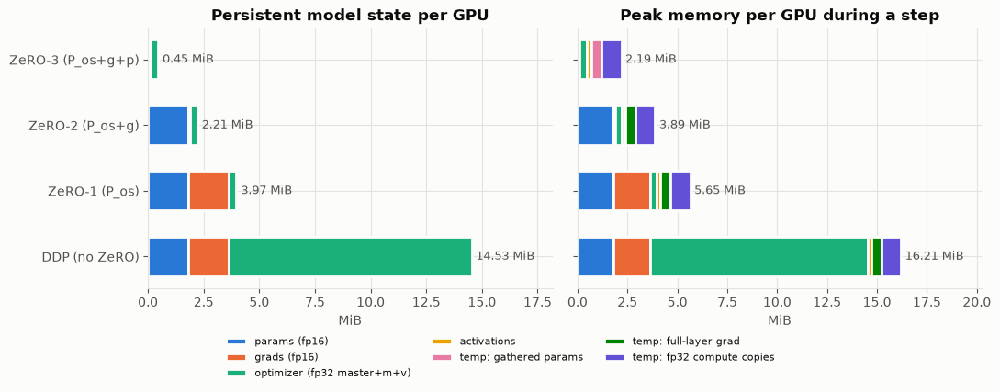
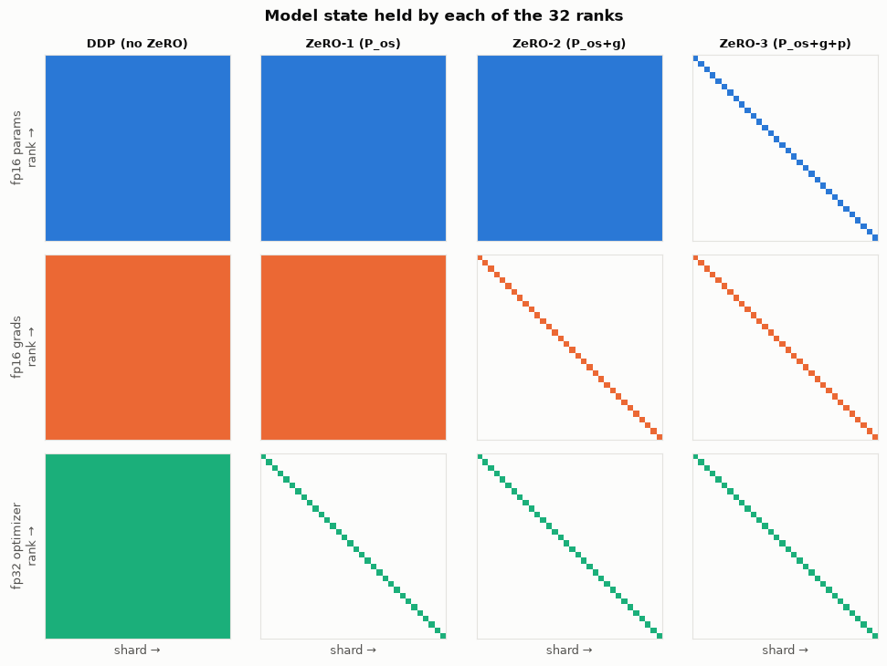
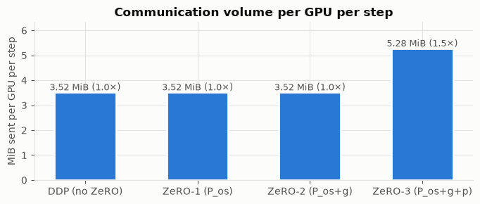
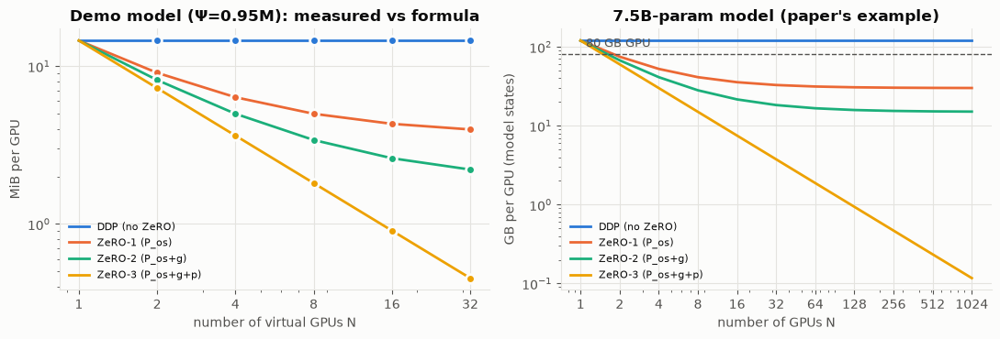
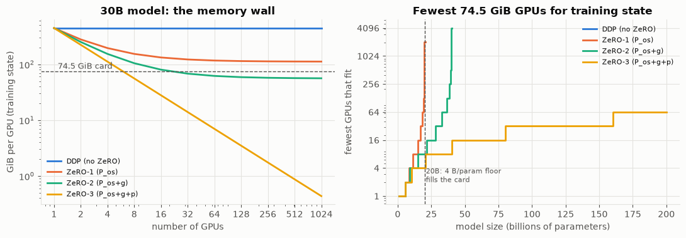

# ZeRO on 32 virtual GPUs

A small simulator that trains one model four ways on a **32-device virtual cluster**:
plain data parallelism (DDP), **ZeRO-1**, **ZeRO-2** and **ZeRO-3**. It measures how
per-device **memory**, **communication** and **computation** change at each stage.

Everything runs on CPU with numpy. Each "GPU" is a thread with its own memory
ledger, and the ranks exchange real arrays through collective operations.

| File | What it is |
|---|---|
| [`zero_demo.ipynb`](zero_demo.ipynb) | **Everything**: the simulator (virtual GPUs, collectives, model, the 4 training modes), the experiments, tables and plots. Already executed. |
| [`figures/`](figures) | The plots, exported from the notebook |

## Running it

```bash
pip install numpy matplotlib jupyter
jupyter notebook zero_demo.ipynb        # or: open it in Google Colab and "Run all"
```

The notebook is fully self-contained (no `.py` files), so on Colab you only need to upload
the `.ipynb`. It needs only numpy and matplotlib. A full run takes about 15 seconds on a laptop.

---

## My understanding of ZeRO

### 1. Why 16 bytes per parameter in DDP
Mixed-precision training keeps several copies of each weight:
- fp16 weight for the forward and backward pass: 2 B
- fp16 gradient: 2 B
- Adam's fp32 state: 12 B, which is three fp32 values at 4 B each:
  - a master copy of the weight (updating in fp16 would lose small updates to rounding),
  - momentum m,
  - variance v.

In DDP every GPU holds all of it: 2 + 2 + 12 = 16 B. In the notebook that's 14.53 MiB on every one of the 32 GPUs, all identical.

### 2. What each stage splits, and why in that order
- ZeRO-1 splits the optimizer state.
- ZeRO-2 also splits the gradients.
- ZeRO-3 also splits the weights.

The order goes from cheapest to most expensive to split:
- **Optimizer state:** only used in the update step, which is element-wise. Each GPU can update just its own slice and lose nothing. It's also the biggest chunk (12 of 16 B), so you get the most saving for the least effort.
- **Gradients:** a GPU only needs gradients for the slice it updates, so the rest can be dropped once they've been sent off.
- **Weights:** every GPU needs every layer for its forward and backward pass. Splitting them means gathering each layer before it's used, which is the only change that adds communication.

### 3. Why ZeRO-1 and ZeRO-2 cost no more communication than DDP
A ring all-reduce is done in two phases:
- a reduce-scatter, after which each GPU holds the sum for one slice,
- an all-gather, which shares those slices so everyone has the full result.

DDP all-reduces the gradients. ZeRO-1/2 reduce-scatter the gradients, update the slice, then all-gather the updated weights. That's the same two phases with the update moved in between. Both cost about 2Ψ per GPU, and the notebook measured 3.52 MiB per step for all three.

### 4. Why ZeRO-3 costs 1.5×
Weights are split, so each layer must be gathered every time it's needed:
- **All-gather 1 (Ψ):** in the forward pass, because you need the layer to compute its output.
- **All-gather 2 (Ψ):** in the backward pass, because the gathered weights were thrown away after the forward pass to save memory, and the backward pass needs them again.
- **Reduce-scatter (Ψ):** of the gradients.

Total: 3Ψ instead of 2Ψ. There's no all-gather after the update, since each GPU keeps only its own slice. The notebook shows 10 all-gathers + 5 reduce-scatters per step for the 5 layers, and 5.28 MiB sent.

### 5. Why ZeRO-1/2 hit a floor while ZeRO-3 keeps falling
Whatever stays copied on every GPU doesn't shrink as N grows:
- ZeRO-1 still copies fp16 weights + grads: 4Ψ + 12Ψ/N, so it tends to 4 B per parameter.
- ZeRO-2 still copies the fp16 weights: 2Ψ + 14Ψ/N, so it tends to 2 B per parameter.
- ZeRO-3 copies nothing: 16Ψ/N.

For a 30B model, the 4 B floor is 111.8 GiB, more than an 80 GB card, so ZeRO-1 can't fit however many GPUs you add.

### 6. Why the final model is bitwise identical in all four runs
ZeRO changes where the numbers are stored, not what is computed:
- The gradient sum is done in the same order, so a slice of the sum equals the sum of the slices.
- Adam is element-wise, so updating a slice gives exactly the same values as updating the whole and taking that slice.

The notebook checks this: max difference = 0.

### 7. What ZeRO doesn't save
- **Activations:** saved during the forward pass for use in the backward pass. Their size depends on batch size and sequence length, and stages 1–3 don't split them. Use activation checkpointing: recompute activations in the backward pass, at roughly 30% extra compute. ZeRO-R can also split the checkpointed activations across GPUs.
- **Temporary buffers:** one gathered layer (ZeRO-3), one full gradient before it's reduce-scattered, and fp32 compute copies. ZeRO-3's peak (2.19 MiB) is about one layer's working buffers. That's why the largest single layer plus the activations must still fit on one card.
- **Offload:** to go beyond GPU memory, ZeRO-Offload/Infinity move state to CPU RAM or NVMe.

### 8. When to choose ZeRO-2 over ZeRO-3
Use ZeRO-2 when the model already fits with ZeRO-2. It avoids the extra 50% communication and the per-layer gathers, which slow things down on slower interconnects or at small batch sizes, where there's too little compute to hide the communication behind.

Use ZeRO-3 when ZeRO-2 doesn't fit:
- the model is too large for its 2 B/param floor (over about 40B parameters on an 80 GB card), or
- you have few GPUs. For the 30B example: 8 GPUs needs ZeRO-3, while 32+ GPUs can use ZeRO-2 and communicate less.

---

## How the simulator works

### Virtual GPUs
`VirtualGPU` is a memory ledger. Every tensor a rank keeps goes through
`alloc(name, category, array)` / `free(name)`. The ledger tracks the current bytes per
category and the peak (with its breakdown). The categories are fp16 params, fp16 grads,
fp32 optimizer states, activations, and short-lived buffers (gathered params, full-layer grads, fp32 compute copies).

### Collectives
`Communicator` runs 32 threads in lockstep using a `threading.Barrier`:

1. each rank posts its array,
2. barrier,
3. each rank computes its own output (a sum, its slice of the sum, or the concatenation),
4. barrier, so nobody overwrites a slot while others are still reading it.

Each call is charged what a **ring** implementation sends per rank:

| collective | bytes sent per rank (message of M bytes, N ranks) |
|---|---|
| all-reduce | 2(N−1)/N · M |
| reduce-scatter | (N−1)/N · M |
| all-gather | (N−1)/N · M |

Reductions always sum in rank order in fp32. A slice of the sum is therefore exactly
the sum of the slices, so all modes can be compared bit for bit.

### Model
A 5-layer MLP (256→512→512→512→512→64, Ψ = 952,384 parameters) regressing a fixed
random teacher. Each rank trains on its own micro-batch of 16. Training uses
mixed-precision Adam, as in the paper:

* fp16 weights (2 B) + fp16 grads (2 B) + fp32 master weights, momentum and variance (12 B) = **16 B/param**.

Each layer's (W, b) is one flat vector, padded to a multiple of 32 and cut into 32 shards.
Rank r owns shard r of every layer.

### The four modes (`Worker.train_step` in the notebook)

| | forward | backward | optimizer step |
|---|---|---|---|
| **DDP** | full local params | all-reduce each layer's grad | every rank updates all Ψ |
| **ZeRO-1** | full local params | keep full local grad | reduce-scatter grads → update own shard → **all-gather** fp16 params |
| **ZeRO-2** | full local params | **reduce-scatter each layer's grad right away**, keep only own shard | update own shard → all-gather fp16 params |
| **ZeRO-3** | **all-gather** each layer, use it, free it | all-gather again, compute grad, reduce-scatter, free | update own shard, no gather (params stay sharded) |

## Results (32 virtual GPUs, measured)

**Correctness.** All four runs give the same loss curve and **bitwise-identical** final
parameters (max |Δ| = 0). ZeRO changes where state lives. It does not change the math.

**Memory, persistent model state per GPU:**

| stage | params | grads | optimizer | total | bytes/param | paper formula |
|---|---|---|---|---|---|---|
| DDP | 1.817 MiB | 1.817 | 10.899 | **14.53 MiB** | 16.0 | (2+2+12)Ψ |
| ZeRO-1 | 1.817 | 1.817 | 0.341 | **3.97 MiB** | 4.375 | 4Ψ + 12Ψ/N |
| ZeRO-2 | 1.817 | 0.057 | 0.341 | **2.21 MiB** | 2.44 | 2Ψ + 14Ψ/N |
| ZeRO-3 | 0.057 | 0.057 | 0.341 | **0.45 MiB** | 0.50 | 16Ψ/N |

Peak memory during a step also counts activations, which ZeRO does not shard, and every
short-lived buffer a rank creates: one layer's full gradient before it is reduced, one layer's
gathered parameters in ZeRO-3, and fp32 copies used for compute. Peak per GPU is
16.21 / 5.65 / 3.89 / 2.19 MiB. In ZeRO-3, the peak is dominated by *one layer's* working
buffers, not by the model.




**Communication per GPU per step:**

| stage | collectives | MiB sent | × DDP |
|---|---|---|---|
| DDP | 5 all-reduce | 3.52 | 1.0 |
| ZeRO-1 | 5 reduce-scatter + 5 all-gather | 3.52 | 1.0 |
| ZeRO-2 | 5 reduce-scatter + 5 all-gather | 3.52 | 1.0 |
| ZeRO-3 | 10 all-gather + 5 reduce-scatter | 5.28 | **1.5** |



**Computation.** Forward/backward FLOPs per rank are identical in all modes, because each
rank still runs the whole model on its own data. Optimizer work per rank drops to **1/32**
in all ZeRO stages. The number of synchronization points per step goes 5 → 10 → 10 → 15.
That shows up as wall time (≈77 → 90 → 89 → 115 ms here). The "network" is a thread
barrier, so only the trend matters, not the absolute numbers.

**Scaling.** Re-running with N = 2…32 matches the formulas exactly. It is exact because N divides every layer's size; otherwise per-layer padding adds a few bytes. ZeRO-1 and ZeRO-2 level
off at the 4Ψ / 2Ψ they still replicate. ZeRO-3 keeps falling as 1/N. For the paper's 7.5B
model on 64 GPUs the formulas give 120 / 31.4 / 16.6 / 1.9 GB, matching Figure 1 of the paper.



**The memory ladder: a 30B model on 80 GB (74.5 GiB) cards** (training state only, activations extra):

| | 8 GPUs | 16 GPUs | 32 GPUs | 64 GPUs | comm |
|---|---|---|---|---|---|
| DDP | 447.0 GiB ✗ | 447.0 ✗ | 447.0 ✗ | 447.0 ✗ | 2P |
| ZeRO-1 | 153.7 ✗ | 132.7 ✗ | 122.2 ✗ | 117.0 ✗ | 2P |
| ZeRO-2 | 104.8 ✗ | 80.3 ✗ | 68.1 ✓ | 62.0 ✓ | 2P |
| ZeRO-3 | 55.9 ✓ | 27.9 ✓ | 14.0 ✓ | 7.0 ✓ | 3P |

DDP and ZeRO-1 never fit, because the replicated fp16 weights and grads alone are 4 B × 30B = 111.8 GiB per card.
That floor fills a card at exactly 20B parameters. ZeRO-2's 2 B/param floor stops it at 40B, and only ZeRO-3 keeps scaling.



## Limitations (deliberately out of scope)

* No real network: bandwidth, latency and compute/communication overlap are not modelled.
  Byte counts are exact; times only show the trend.
* No bucketing/prefetching, ZeRO-Offload/Infinity, ZeRO-R activation partitioning, or fp16 loss scaling.
* Threads share one Python process (GIL), so this simulates *what* each GPU holds and sends, not real speedups.

## Reference

S. Rajbhandari, J. Rasley, O. Ruwase, Y. He. *ZeRO: Memory Optimizations Toward Training
Trillion Parameter Models.* SC 2020. [arXiv:1910.02054](https://arxiv.org/abs/1910.02054)
