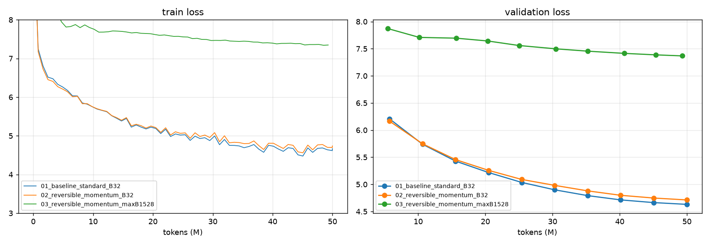
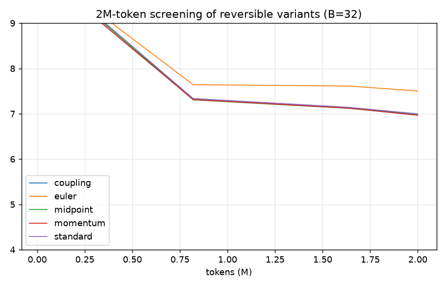
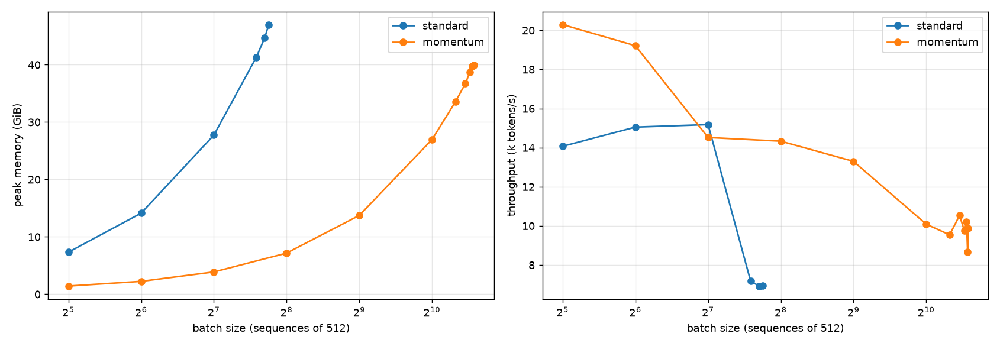

# Session 13: training a 20M-parameter GPT with reversible residual streams

Three training runs of the same 20M-parameter GPT, each on the same 50M tokens of FineWeb-Edu:

1. **Baseline:** a standard transformer at a fixed batch size (32 × 512 tokens).
2. **Reversible:** the same model with a reversible residual stream, at the same batch size.
   Five variants were screened first (coupling/RevNet, midpoint/leapfrog, momentum, plain Euler with
   fixed-point inversion), and the best one, **momentum**, was trained in full.
3. **Reversible at max batch:** the same reversible model at the largest batch that sustains training,
   **1,528 × 512 = 782k tokens per step**, 7.1× the standard model's maximum of 216.

Everything ran locally on an **Apple M4 Max (40-core GPU, 64 GB unified memory)** using PyTorch 2.15
with the MPS backend in fp32. The notebooks also run unchanged on Google Colab (CUDA, bf16 autocast).

## Results

| Run | Architecture | Batch (seq × 512) | Steps | Final train loss | Final val loss | Throughput (tok/s) | Peak memory | Wall time |
|---|---|---|---|---|---|---|---|---|
| 1. Baseline | standard | 32 (16k tok) | 3,051 | **4.628** | **4.631** | **17,012** | 7.31 GiB (7.50†) | 49.0 min |
| 2. Reversible | momentum (γ=0.9) | 32 (16k tok) | 3,051 | 4.705 | 4.713 | 13,857 | **0.80 GiB (1.60†)** | 60.1 min |
| 3. Reversible, max batch | momentum (γ=0.9) | **1,528** (782k tok) | 63 | 7.358 | 7.368 | 9,973 | 39.95 GiB† | 82.2 min |

- *Final train loss:* mean logged training loss over the last 10% of tokens.
- *Final val loss:* measured on 1M held-out FineWeb-Edu tokens (20 batches × 16 sequences × 512).
- *Throughput:* training only (evaluation excluded), averaged over the whole run, excluding the first 3 steps.
- *Peak memory:* the allocator peak. † marks the fine-grained measurement, which also captures
  temporary memory inside each layer; see [How memory was measured](#how-memory-was-measured).
  Runs 1 and 2 recorded the coarse number during training, and their † values were re-measured at
  B=32 with the fine-grained tracker.



### Headline findings

1. **Reversibility cuts activation memory by 4.7× at equal batch size:** 7.50 → 1.60 GiB at B=32
   (fine-grained). Per additional sequence of 512 tokens, the standard model needs **0.216 GiB** and
   the reversible one **0.026 GiB**, 8.4× less. About 0.6 GiB of the reversible footprint is weights,
   gradients and AdamW state (40.8M fp32 parameters); the rest is one layer's temporary activations.
2. **It costs 19% throughput** at B=32 (17.0k → 13.9k tok/s). Theory predicts about 25%, since each
   layer is recomputed once in the backward pass (4 instead of 3 units of work per layer).
3. **Max batch: 216 → 1,528 sequences (7.1×).** The reversible model's memory grows so slowly with
   batch size that, on this Mac, it first hits an *MPS backend limit* (INT_MAX elements in one
   tensor) and only then real memory.
4. **The reversible model is 0.08 nats worse at equal steps** (4.713 vs 4.631). This comes from the
   *momentum architecture*, not from numerical error: gradients match plain autograd to 6e-5 even
   after training.
5. **Pushing to the max batch on a fixed 50M-token budget is a bad trade.** With 48× more tokens per
   step, the run gets only 63 optimizer steps and ends at **7.37** validation loss. The B=32 runs
   passed that point after only about 50 steps (0.8M tokens). The critical batch size of a 20M model
   this early in training is far below 782k tokens, so most of those tokens are wasted, and per-token
   speed also drops (9.97k vs 13.9k tok/s) under memory pressure.

## Which reversible variant worked?

Every variant uses identical blocks (one attention and one MLP per layer, 40.77M parameters), and
they differ only in how block outputs feed the residual stream. Here f(x) = Attn(x) + MLP(x + Attn(x))
is the residual update of one standard block.

| Variant | Forward update | Inverse used in backward | Exact? |
|---|---|---|---|
| `coupling` (RevNet / Reformer, a symplectic-Euler step on a split state) | y₁ = x₁ + Attn(x₂); y₂ = x₂ + MLP(y₁) | x₂ = y₂ − MLP(y₁); x₁ = y₁ − Attn(x₂) | yes |
| `midpoint` (explicit midpoint / leapfrog) | xₙ₊₁ = xₙ₋₁ + 2h·f(xₙ), h = ½ | xₙ₋₁ = xₙ₊₁ − 2h·f(xₙ) | yes |
| `momentum` (Momentum ResNet, γ = 0.9) | v′ = γv + (1−γ)f(x); x′ = x + v′ | x = x′ − v′; v = (v′ − (1−γ)f(x)) / γ | yes (divides by γ) |
| `euler` (plain residual) | x′ = x + f(x) | fixed-point x ← x′ − f(x), 10 iterations | **no** |

**Numerical checks** (`results/02_numerical_checks.json`). Reconstruction error is the max relative
error after running all 12 layers forward and then inverting them. Gradient error is the relative L2
error of reversible-backward gradients against plain autograd on the same weights. "4× weights"
scales every block weight by 4, as a stress test standing in for a trained network with larger
residual updates.

| Variant | Recon err (init) | Grad err (init) | Recon err (4× weights) | Grad err (4× weights) |
|---|---|---|---|---|
| coupling | 6.6e-6 | 1.9e-6 | 9.1e-3 | 2.7e-4 |
| midpoint | 6.8e-6 | 1.9e-6 | 1.2e-2 | 1.5e-4 |
| **momentum** | **3.5e-6** | **1.7e-6** | **1.6e-4** | 2.5e-4 |
| euler | 1.4 | 0.84 | 32 | 0.50 |

After the full 50M-token run, momentum still had reconstruction error 1.1e-4 and gradient error 6.2e-5.

**Screening runs:** 2M tokens each (122 steps) at B=32 (`results/02_screen_*.json`).

| Variant | Val loss @ 2M tok | Throughput (tok/s) | Peak memory (coarse) |
|---|---|---|---|
| standard (reference) | 7.137 | 16,835 | 7.31 GiB |
| coupling | 7.121 | 14,245 | 0.78 GiB |
| midpoint | 7.114 | 13,722 | 0.80 GiB |
| **momentum** | **7.109** | 13,195 | 0.80 GiB |
| euler | 7.619 | 6,115 | 0.71 GiB |



**What worked: `momentum`, and also coupling and midpoint.** All three exactly invertible schemes
reproduce autograd gradients to about 2e-6 and train as well as the standard model over 2M tokens,
or very slightly better. They end within 0.03 of each other, which is within noise at this length.
`momentum` was selected automatically because it had the lowest screening loss and the most robust
inversion. Under the 4× weight stress test its reconstruction error is about 60× smaller than
coupling's or midpoint's. Its (1 − γ) factor shrinks each layer's update, so the inverse subtracts
small terms from large ones and loses less precision, while the 1/γ division amplifies error by
only 1/0.9 per layer.

**What did not work: plain `euler`.** A standard residual block has no closed-form inverse, and the
fixed-point iteration x ← y − f(x) converges only if f is a contraction. With pre-LayerNorm blocks,
f(x) doesn't shrink as x does, because the LayerNorm normalizes it, so the iteration fails even at
initialization (reconstruction error 1.4). The resulting gradients are 84% wrong. The model still
learns a little, since the gradients are wrong but correlated with the true ones, but it ends the
screen 0.5 nats behind the others at less than half the speed (10 extra block evaluations per layer
in the backward pass).

**What the 50M-token run showed that the screen could not.** Momentum was *ahead* of the baseline
at 5M tokens (6.164 vs 6.207). It fell behind steadily up to about 30M tokens, and the gap then
held at about 0.08 to the end:

| Tokens | 5M | 10M | 15M | 20M | 25M | 30M | 35M | 40M | 45M | 50M |
|---|---|---|---|---|---|---|---|---|---|---|
| baseline val | 6.207 | 5.739 | 5.428 | 5.217 | 5.036 | 4.899 | 4.792 | 4.713 | 4.664 | **4.631** |
| momentum val | 6.164 | 5.747 | 5.455 | 5.258 | 5.091 | 4.981 | 4.880 | 4.798 | 4.748 | **4.713** |

The gradients stay exact, so this is an architectural effect. With γ = 0.9, each layer adds only
0.1·f(x) to a velocity that persists across layers. The effective residual update is a smoothed,
lagged average over depth, which gives each layer less independent capacity than a plain residual
connection. Coupling or midpoint may well close this gap. They were statistically tied in the screen,
and a 50M-token run of each is the natural follow-up. The 2M-token screen was too short to separate them.

## Pushing to the maximum batch size

`revllm.find_max_batch` doubles the batch, then binary-searches to a multiple of 8. Each probe runs
full training steps (forward, backward and AdamW) on a fresh model.

| | Standard | Reversible (momentum) |
|---|---|---|
| Max batch | **216** sequences (110k tok/step) | **1,528** sequences (782k tok/step) |
| First failure | B=224, out of memory | B=1,536, out of memory |
| Peak memory at max (fine-grained) | 47.0 GiB | 40.0 GiB |
| Memory per extra sequence | 0.216 GiB | 0.026 GiB |
| Throughput at max (probe) | ~6.9k tok/s | ~9.9k tok/s |



Getting the reversible model to its real limit took three fixes, and each one is a finding in itself:

1. **The MPS INT_MAX limit.** PyTorch's MPS attention materializes the full (B, heads, T, T) score
   matrix, and MPSGraph refuses any tensor with more than 2³¹ − 1 elements. At B=1,536 that matrix is
   1,536 × 6 × 512 × 512 = 2.4 billion elements, and the first search crashed there, at a batch
   size memory alone would have allowed. Fix: split attention over the batch whenever the score
   matrix would exceed 2³⁰ elements. Each sequence's attention is independent, so the output is
   identical (max abs difference 0.0), and runs 1 and 2 at B=32 are unaffected.
2. **Fine-grained memory sampling.** Sampling only between layers missed temporary memory inside a
   layer (attention scores, the 4×-wide MLP activations). That matters little for the standard model,
   whose stored activations dominate, but the reversible footprint *is* those temporaries.
   Sampling after every Linear, LayerNorm and attention call, and on each of their gradients,
   raised the reversible B=32 peak from 0.80 to 1.60 GiB. Even this is a lower bound, since memory
   used *inside* a single op is invisible.
3. **Allocator fragmentation.** B=1,528 passed the 2-step probe but ran out of memory around step 6
   of real training. So did 1,464, 1,400 and 1,336 (logs in `results/failed/attempt1/`). Allocated
   memory returned to 0.46 GiB after every step, so nothing leaked. But the Metal driver's cached
   memory swung between 19 and 52 GiB from step to step, because 4–5 GiB temporary buffers were
   allocated and freed in mixed sizes. Fix: when a step holds over 256k tokens, release cached
   memory after every step, so each step starts from the same clean allocator state. That costs
   under a second against an 80-second step. B=1,528 then trained the full 63 steps on the first try.

**Was it worth it?** On a fixed 50M-token budget, no. See the green curve above: 63 huge steps
reach 7.37, a loss the B=32 runs passed after about 50 small steps. On a short run, 48× fewer
updates cost far more than the lower gradient noise buys back, and a learning rate scaled by
√(B/32) and capped at 3e-3 can't make up the difference. Throughput also drops
from about 20k tok/s (B=32 probe) to about 10k at B=1,528, because a near-full 52 GiB working set
in unified memory competes with the OS. The memory headroom pays off when the batch is fixed by
something else (a longer context, a deeper model, or data parallelism), not when it is chased for
its own sake.

## Setup details

| | |
|---|---|
| Data | FineWeb-Edu `sample/10BT/000_00000.parquet`, first 48,916 documents, tokenized with GPT-2 BPE (`tiktoken`) plus `<\|endoftext|>` per doc. 1.0M val tokens, then 50.5M train tokens. |
| Data order | Non-overlapping 512-token windows in one fixed shuffled order, the same for every run. Single epoch, so each token is seen once. |
| Model | GPT-2-style, pre-LN, 12 layers, d_model 384, 6 heads, MLP 4×, context 512, learned positions, tied embeddings |
| Parameters | **21.25M non-embedding** (the "20M"); 40.77M total, including the 50,304 × 384 tied embedding table |
| Optimizer | AdamW (β = 0.9, 0.95), weight decay 0.1 on matrices, grad clip 1.0 |
| LR schedule | Runs 1 and 2: 1e-3 peak, 2% linear warm-up, cosine to 10%. Run 3: 3e-3 peak (√(B/32) scaling, capped), 5% warm-up |
| Loss head | LM head plus cross-entropy in checkpointed 4,096-token chunks in **every** run, so the 50k-vocab logits never dominate memory and the comparison isolates the transformer blocks |
| Precision | fp32 on MPS. On CUDA: bf16 autocast inside blocks, residual streams kept in fp32 for exact inversion |
| Hardware | Apple M4 Max, 40-core GPU, 64 GB unified memory. MPS allocator limit 51.8 GiB (`PYTORCH_MPS_HIGH_WATERMARK_RATIO=1.0`) |

### How the reversible backward works

`revllm._RevStack` is a custom `torch.autograd.Function`. Its forward pass runs all 12 blocks under
`no_grad` and saves **only the final state**. Its backward pass walks the layers in reverse; for
each one it:

1. rebuilds the layer's input from its output (the exact inverse),
2. re-runs the sub-blocks once with grad enabled, reusing that recomputation for the inverse, and
3. back-propagates the incoming gradient through them, accumulating parameter gradients.

Live memory is therefore the final state plus one layer's activations, whatever the depth.
`revllm.gradient_error` checks this against plain autograd through the same equations.

### How memory was measured

PyTorch's MPS backend has no `max_memory_allocated()`. `revllm.MemTracker` therefore samples
`torch.mps.current_allocated_memory()` at every point where the peak can occur:

- after every Linear, LayerNorm and attention call in the forward pass, including the recomputation
  inside the reversible backward,
- when each of their output gradients is produced in the backward pass,
- after the loss and after the optimizer step.

The reported number is the maximum of these samples, a tight lower bound on the true allocator peak.
Runs 1 and 2 used the coarse first version, which sampled only between layers. On CUDA, the code
uses `torch.cuda.max_memory_allocated()`. The Metal driver footprint
(`driver_peak_mem_bytes` in the JSON files) includes cached blocks, which can stay at 11+ GiB
across runs in the same notebook process, so it is reported but not used for comparison.

### Throughput notes

- The Mac's throughput drifted during the long runs, between about 12k and 20k tok/s for the same
  configuration, because of thermal and power state and background load on a laptop; the logs keep
  every 50-step window. The averages in the results table cover whole runs. A dedicated
  back-to-back probe on a quiet machine gives a cleaner B=32 comparison: **23.2k (standard) vs
  20.4k (reversible) tok/s**, a 12% cost. Single-step probes in the batch search are noisy; the
  first probe after start-up, standard at B=32, read only 14.1k.
- The reversible slowdown on MPS (12–19%) is below the theoretical 25% because at d_model 384,
  part of each step is fixed overhead (kernel launches, the LM head, the optimizer), and the
  recomputation doesn't touch it.

## Repository layout

| File | Purpose |
|---|---|
| `00_prepare_data.ipynb` | builds `data/train.bin` and `data/val.bin` (FineWeb-Edu slice) |
| `01_baseline.ipynb` | Run 1: standard GPT, B=32, 50M tokens |
| `02_reversible.ipynb` | numerical checks, 2M-token screening of 5 variants, Run 2: momentum, B=32, 50M tokens |
| `03_reversible_max_batch.ipynb` | max-batch search (standard vs reversible), Run 3: reversible at B=1,528 |
| `04_report.ipynb` | summary table and plots (`figures/`) |
| `revllm.py` | model, all reversible variants, custom backward, memory tracker, trainer, max-batch search |
| `prepare_data.py` | download and tokenize (`--from-jsonl` for environments without `pyarrow`) |
| `tools/export_text.py` | parquet → JSONL text export (used locally) |
| `make_notebooks.py` | generates the notebooks; `run_all.sh` executes them in order |
| `results/` | per-run JSON (full loss/throughput history), training logs, search and check results; `failed/` holds the logs of the out-of-memory attempts |

### Reproduce

```bash
# locally (Apple Silicon or CUDA); needs torch, numpy, tiktoken, pyarrow, matplotlib, nbconvert
python prepare_data.py
./run_all.sh 01_baseline.ipynb 02_reversible.ipynb 03_reversible_max_batch.ipynb 04_report.ipynb
```

On **Google Colab**, open any notebook with a GPU runtime. The first cell clones this branch,
installs `tiktoken` and `pyarrow`, and prepares the data automatically. On CUDA, the max batch will
differ: memory-efficient attention avoids materializing the score matrix, and bf16 halves activation size.
