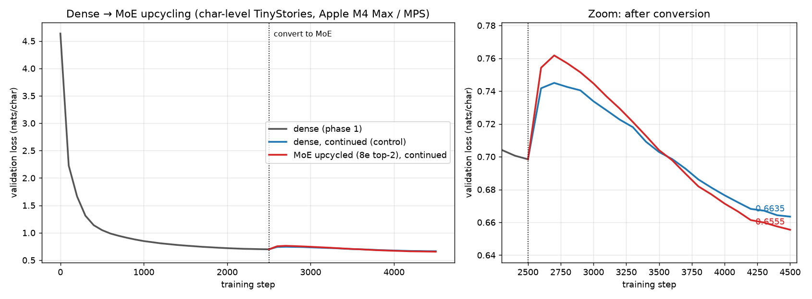

# Dense → MoE upcycling on Apple Silicon

Train a small dense GPT whose FFNs are plain `nn.Linear` layers, convert every FFN
into a **Mixture-of-Experts** ("sparse upcycling"), and show that the MoE **keeps
training and reducing loss**. The MoE also ends below a dense control trained for
the same number of extra steps.

Everything runs on a MacBook (Apple M4 Max, PyTorch MPS backend) in about 37 minutes.



## Results

Validation loss (nats/char) on a fixed held-out set:

| | step 2500 (conversion) | step 4500 (+2000 steps) |
|---|---|---|
| Dense, continued (control) | 0.6984 | 0.6635 |
| **MoE, upcycled** | **0.6984** (Δ = 3e-9) | **0.6555** |

- **Exact conversion:** at conversion time the MoE computes the dense function, so loss is unchanged.
- **MoE keeps learning:** 0.698 → 0.656. It passes the dense control around step 3,600 and the gap is still widening at step 4,500.
- **Balanced experts:** in every layer each of the 8 experts gets 11–14% of tokens at the end (uniform = 12.5%).
- **Bump after conversion:** both arms re-warm the learning rate from 1e-4 to 6e-4. The MoE bumps higher because its router is freshly initialised. A lower continuation learning rate or no re-warmup should shrink this.

Full training logs: [`logs/train.log`](logs/train.log) (stdout of the run, with per-layer
expert load) and [`logs/results.json`](logs/results.json) (every eval point, config,
parameter counts, final expert load per layer, and text samples).

## Setup

| | |
|---|---|
| Data | [TinyStories](https://huggingface.co/datasets/roneneldan/TinyStories) `TinyStories-valid.txt`, character-level (vocab 98), 18.5M train / 0.97M val chars |
| Dense model | GPT, 6 layers, d=384, 6 heads, ctx 256, **10.8M params** |
| MoE model | Each FFN → 8 experts, top-2 routing, **60.4M total / 17.9M active** params |
| Phase 1 | Dense, 2500 steps, batch 64×256, AdamW, lr 1e-3 cosine |
| Phase 2/3 | MoE and dense control from the same checkpoint, 2000 steps each, lr 6e-4 cosine, same data order |

### How the conversion works (`upcycle()` in `train.py`)

1. Each expert is a `deepcopy` of the trained dense FFN (`Linear → GELU → Linear`).
2. A new router `Linear(d, 8)` is initialised with std 0.02.
3. The top-2 gate weights are renormalised to sum to 1. Because all experts are identical
   at init, the output equals the dense FFN exactly, whatever the router does.
4. Training adds a Switch-style load-balancing loss (`0.01 · E · Σ fᵢ·Pᵢ`). Experts
   diverge because each one receives different tokens.

## Run it

```bash
python3.12 -m venv .venv
.venv/bin/pip install -r requirements.txt
mkdir -p data && curl -L -o data/tinystories_valid.txt \
  https://huggingface.co/datasets/roneneldan/TinyStories/resolve/main/TinyStories-valid.txt
.venv/bin/python train.py | tee logs/train.log   # ~37 min on M4 Max
.venv/bin/python plot.py                          # -> loss_curves.png
```

Uses MPS when available, otherwise CPU. Checkpoints (`dense.pt`, `moe.pt`) are written
locally but not committed, because `moe.pt` is 240 MB.

## Apple Silicon notes

- An MoE step takes ~2.5× as long as a dense step on MPS (~0.5–0.7 s vs ~0.2 s). Most of the cost is MPS dispatch overhead, not FLOPs.
- Tokens are sorted by expert so there is one host sync per layer, and each expert's batch is padded to a multiple of 1024 to limit kernel shape churn.
- bf16 autocast was *slower* than fp32 for this model on MPS, so the run uses fp32.
